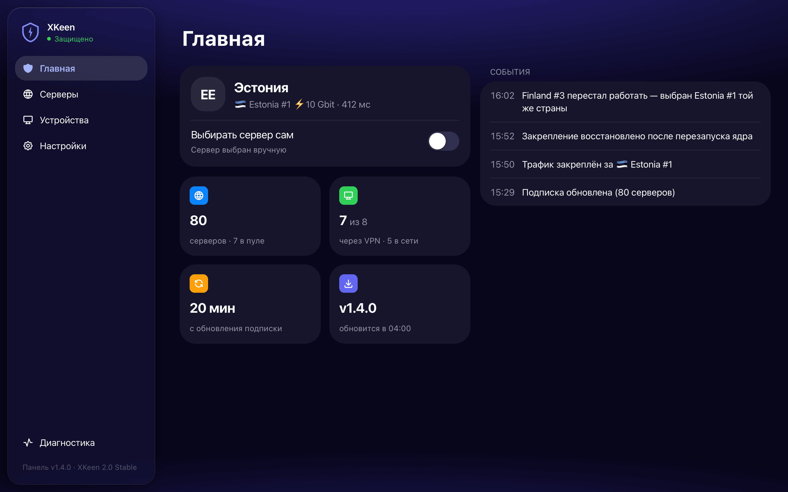
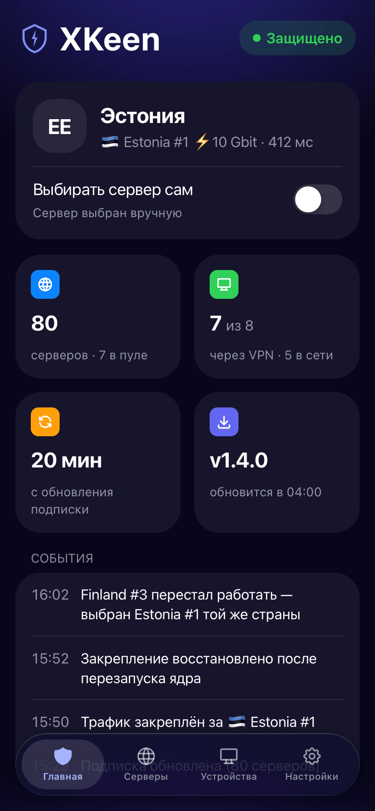
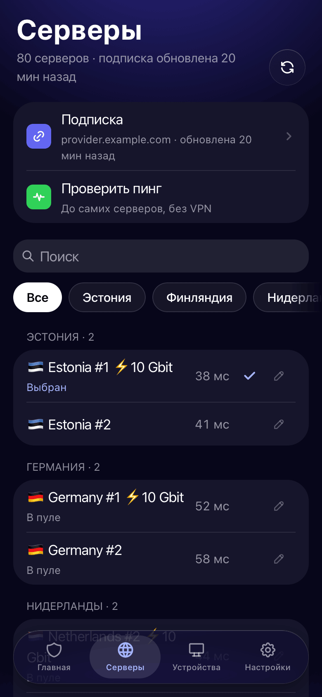

# XKeen Panel

Web panel for managing [XKeen](https://github.com/jameszeroX/XKeen)/Xray on Keenetic routers.

Supports both the jameszeroX fork (**XKeen 2.x**, `S05xkeen`) and the original
Skrill0 layout (1.x, `S24xray`) — the layout, the active proxy core
(Xray/Mihomo) and the proxying mode are detected at startup.

<p align="center">
  
</p>
<p align="center">
  
  
  
  
</p>

## Features

- **First-run wizard** — subscription, devices and launch in three steps; on a
  fresh XKeen install the panel writes the whole Xray config itself
- **Balancer pool** — the fastest servers of the subscription in a `leastPing`
  pool; Xray leaves a dead node without a restart
- **Any server by hand** — pin any subscription server, in the pool or not; if
  it dies, the panel moves to another server of the same country
- **Honest status** — checks go through the proxy via a local Xray inbound, so
  a working router uplink is never mistaken for a working VPN
- **Devices** — choose which devices go through the VPN; the panel manages the
  Keenetic `xkeen` policy through the router's own API
- **Self-update** — installs new releases at night, with rollback
- **XKeen settings** — proxying ports, port and IP exclusions, GitHub proxy
- **Authentication** — passkey (Face ID / Touch ID) or password with TOTP
- **iPhone home screen** — adds as a standalone app

## Installation

### Requirements

- Keenetic router with [Entware](https://help.keenetic.com/hc/ru/articles/360021214160)
  on a USB drive
- Keenetic components **Netfilter kernel modules** (required) and **IPv6
  protocol** (recommended), enabled in the router's general settings

### Quick install

Connect to the router's Entware over SSH (`root`, usually port 222) and run.

Panel and XKeen together, on a router without XKeen:

```sh
curl -fsSL https://raw.githubusercontent.com/Dearonski/xkeen-panel/main/install.sh | sh -s -- --with-xkeen
```

The panel only, when XKeen is already installed — also the way to update:

```sh
curl -fsSL https://raw.githubusercontent.com/Dearonski/xkeen-panel/main/install.sh | sh
```

Then open `http://<router IP>:3000`, create an account and follow the wizard.

Installer options:

| Option | Effect |
|--------|--------|
| `--with-xkeen` | Install XKeen first if it is missing (Xray core, geo databases, no GeoIPSET) |
| `--mihomo` | With `--with-xkeen`, install the Mihomo core as well |
| `--check` | Only check the router — components, free space, GitHub access — and change nothing |
| `aarch64` / `mipsel` | Override the detected architecture |

Downloads fall back to GitHub mirrors when GitHub is unreachable, and the panel
binary is checked against the release's `SHA256SUMS`. An existing
`config.yaml` is never overwritten; the previous binary is kept as
`/opt/sbin/xkeen-panel.bak`.

> Installing XKeen through `--with-xkeen` runs XKeen's own non-interactive
> installer (`xkeen -i auto`) with autostart left off — the wizard turns it on
> once the panel has written a working config.

## Usage

```sh
# Start / stop / restart
/opt/etc/init.d/S99xkeen-panel start
/opt/etc/init.d/S99xkeen-panel stop
/opt/etc/init.d/S99xkeen-panel restart

# Logs
tail -f /opt/var/log/xkeen-panel.log
```

## Configuration

File: `/opt/etc/xkeen-panel/config.yaml`

| Parameter | Default | Description |
|-----------|---------|-------------|
| `port` | `3000` | Web panel port |
| `data_dir` | `/opt/etc/xkeen-panel/data` | Data directory |
| `xkeen_path` | `/opt/sbin/xkeen` | Path to XKeen binary |
| `outbounds_file` | `/opt/etc/xray/configs/04_outbounds.json` | Xray outbounds config |
| `xray_config_dir` | auto | Xray config directory |
| `routing_file` | auto | Routing config; auto-detected among the config files |
| `mihomo_config` | auto | `/opt/etc/mihomo/config.yaml` |
| `xkeen_json` | auto | `/opt/etc/xkeen/xkeen.json` |
| `xray_api_addr` | `127.0.0.1:10085` | Xray gRPC API, used to pin a node |
| `probe_addr` | `127.0.0.1:10086` | Local socks inbound the panel checks the proxy through |
| `check_interval` | `120` | Watchdog check interval (seconds) |
| `check_url` | `https://www.google.com` | URL for connection check |
| `max_fails` | `3` | Consecutive failures before server switch |
| `auto_switch_avoid_countries` | `[RU, BY]` | Countries the pool and automatic switching skip |
| `subscription_refresh_interval` | `1800` | Subscription refresh period (seconds), `0` = off |

Paths left empty are detected on startup, so an install that moved its configs
only needs the ones that differ. Avoided countries and the refresh period can
also be changed in the panel; those choices are stored in `data/settings.json`
and take precedence, so `config.yaml` is never rewritten.

## How the panel edits your config

- **A fresh install is configured from scratch.** When Xray has no proxy
  outbound at all, adding a subscription writes a pool, `direct`/`block`
  outbounds with `sockopt.mark` 255, and routing that sends Russian domains,
  Russian IPs and local networks direct and everything else through the pool.
- **The outbound shape is preserved.** Xray accepts both `settings.vnext[]` and
  the newer flat `settings.{address,port,id}`; whichever your config uses is
  kept, and so is `raw` as the spelling of the `tcp` transport.
- **`streamSettings.sockopt` survives.** XKeen checks `sockopt.mark` on every
  real outbound to proxy the router's own traffic, so the panel merges its
  changes over the existing outbound instead of replacing it.
- **Checks have their own inbound.** The panel adds `00_panel_probe.json` (a
  socks inbound on `probe_addr`) and one rule at the top of the routing file
  sending it where client traffic goes.
- **Comments are read, not written.** Xray configs legally carry `//` and
  `/* */`; the panel parses through them, but a file it writes comes back
  without them. The previous content is always kept as `.bak` next to the file.
- **Every write is validated.** After writing, `xkeen -xtest` (or `-mtest`) runs
  the core's own parser; a rejected config is restored from the backup and the
  error is shown instead of restarting into a broken state.

## Building from source

```sh
# Requirements
go 1.25+
node 20+

# Build for all architectures
make build-all

# Or specific target
make build-arm64   # Keenetic Giga/Ultra/Peak
make build-mipsel  # Keenetic older models

# Output: build/xkeen-panel-{aarch64,mipsel}
```

## Stack

- **Backend:** Go, chi router, JWT, TOTP, WebAuthn, SSE
- **Frontend:** React 19, Vite, Tailwind CSS 4, TanStack Query
- Frontend is embedded into the binary via `go:embed`
